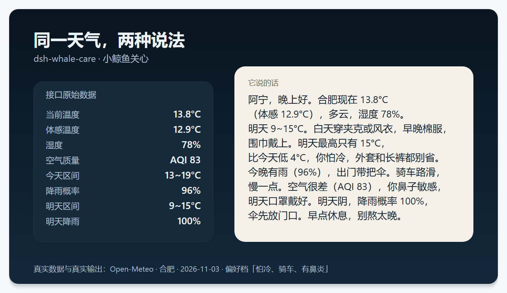
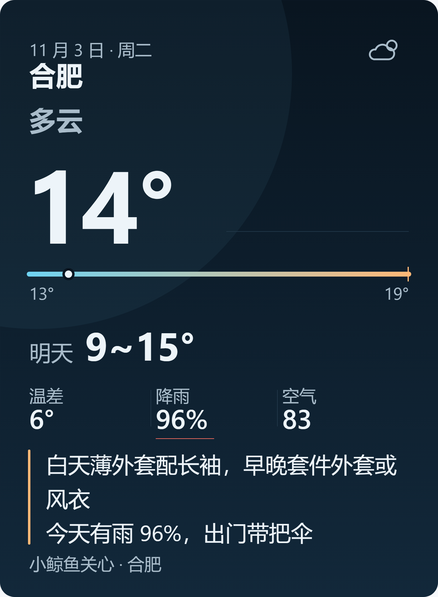
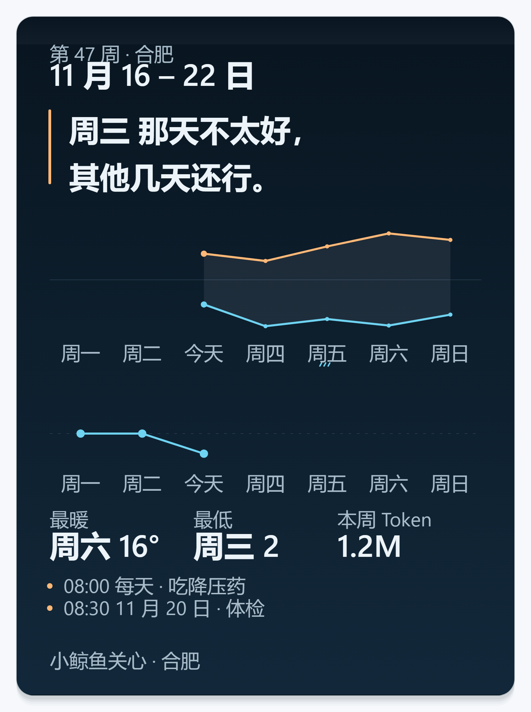
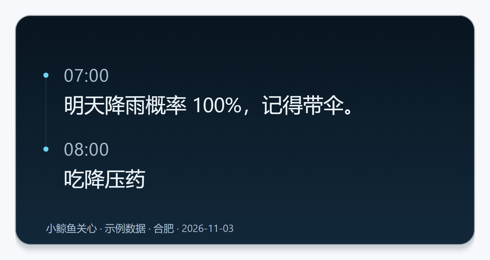

<p align="center">
  
</p>

<h1 align="center">Whale Care</h1>

<p align="center"><sub>dsh-whale-care · teach your agent to actually care</sub></p>

<p align="center">
     
</p>

<p align="center"><b>中文</b> · <a href="README.md">README.md</a></p>

```bash
dsh plugin --profile web add github:fanyingnie2163663/dsh-whale-care
```

Free · no API key · no account · preferences stay on your machine.

<sub>npm still ships 0.5.7; use the GitHub spec above for 0.6.0.</sub>

## Quick start
Restart dsh after installing; three minutes to first use. Start by telling it who you are:
```bash
"Remember: I'm in Hefei, call me A-Ning, I feel the cold, I bike to work, I have a sensitive nose"
```

Then just ask:
```bash
"Umbrella today?" "What should I wear tomorrow?" "Which day this week is coldest?"
```

- **The city is yours to set**: before you set one it says plainly that it cannot tell, and never quietly falls back to some default city; to change city for one question, just say it ("umbrella in Shanghai today?").
- Or ask nothing: one message each morning, switchable, follows your routine; pills and umbrella reminders need a host to wake the agent (see "Optional QQ"). Version gate: dsh `0.1.2-rc.1` ~ `0.2.x`; `0.3` is untested and the peer gate refuses the install.

## What it is
> Work out what actually matters, then say it the way a person would.

- **It knows who you are and what time it is**: nickname, cold/heat sensitivity, commute, umbrella, health notes; "take care on the way" in the morning, "get some rest" at night, no sunscreen after dark;
- **It only says what matters and stays local**: ranked by impact, at most three items, never a rules dump; preferences live in `~/.dsh/whale-weather/profile.json`, nothing is uploaded.

| Setup | What you get | Do reminders fire on time? |
| --- | --- | --- |
| dsh only | all eight tools | No, only when the agent happens to wake up |
| dsh + QQ | all eight tools, plus an allowlist | Yes, reminders every 30s, alerts at 07:00 / 18:00 |

## What it sounds like


<sub>Same weather, two ways: raw API data on the left, what it actually says on the right.</sub>

Same day, same profile (Hefei · 2026-11-03 · feels the cold, bikes, sensitive nose), verbatim:

> 阿宁，晚上好。
> 合肥现在 13.8°C（体感 12.9°C），多云，湿度 78%。
> 明天 9~15°C。
> 白天穿夹克或风衣，早晚棉服，围巾戴上。
> 明天最高只有 15°C，比今天低 4°C，你怕冷，外套和长裤都别省。
> 今晚有雨（96%），出门带把伞。
> 骑车路滑，慢一点。
> 空气很差（AQI 83），你鼻子敏感，明天口罩戴好。
> 明天阴，降雨概率 100%，伞先放门口。
> 早点休息，别熬太晚。
>
> <sub>(actual output is Chinese)</sub>

<details>
<summary>How preferences change it</summary>

| Preference | Effect |
| --- | --- |
| `nickname` | Opens with the name the user wants to be called |
| `coldSensitive` | Warns at a 3°C drop, keeps-warm at ≤8°C |
| `heatSensitive` | Heat warning at 28°C |
| `commute` = `bike` | Rain: slippery roads; wind: do not fight the headwind |
| `commute` = `walk` | Rain: avoid the puddles |
| `hasUmbrella` = false | Rain: "you always forget your umbrella, put one in your bag" |
| `notes` with 鼻 / 咽 / 哮喘 / 过敏 | Poor air: sensitive nose, keep the mask on |

</details>

## Eight tools
After installing, the agent's tool list contains these eight; none needs an API key.

| Tool | One line |
| --- | --- |
| `weather` | Detailed report: current, air, 3-day forecast, generic advice |
| `weather_care` | Caring version: profile and time of day, one sendable message |
| `care_brief` | Short version: at most three items plus today's due reminders |
| `weather_profile` | Read/write preferences: city, nickname, cold/heat, commute, umbrella |
| `weather_reminder` | Reminders: daily / weekdays / one-off / yearly, or weather-conditioned |
| `weather_alert` | Extreme-weather alerts, yellow/orange/red, deduped per day |
| `weather_card` | Render a 720×980 weather card (SVG) for the host to send |
| `weather_mood` | Mood scores 1~5: log, recent entries, trend |

<details>
<summary>What the report contains</summary>

- Current temperature / feels-like / condition / humidity / wind / visibility, plus AQI + PM2.5 + five levels;
- Three days of high/low, condition, chance of rain, wind; at most 4 advice lines, only when relevant (rain ≥40%, wind ≥30km/h, swing ≥10°C, drop ≥5°C, low ≤5°C, UV ≥6, AQI band); Chinese condition mapping ships 40+ WWO entries, since wttr's `lang_zh` does not actually translate.

Sample output (Hefei · 2026-11-03 snapshot):
```text
合肥 现在 13.8°C（体感 12.9°C），多云，湿度 78%，风 18km/h
空气质量 很差（AQI 83，PM2.5 62μg/m³）
今天（11-03）13.2~19°C 多云，降雨概率 96%，风 18km/h
明天（11-04）9~15°C 阴，降雨概率 100%，风 24km/h

建议：
· 降雨概率最高 100%，出门记得带伞
· 空气很差，尽量待在室内
```

</details>

<details>
<summary>Parameters and fields</summary>

`weather` and `weather_care` take `city` (defaults to the profile city) and `days` (1~3, default 3). Fields of `weather_profile`:

| Field | Meaning |
| --- | --- |
| `city` | Default city |
| `lat` / `lon` | Latitude / longitude in decimal degrees (both or neither): district / point precision, see "Locate by coordinates" below |
| `location` | A pasted coordinate string such as `31.8639,117.2808`; same as giving `lat` and `lon` |
| `nickname` | What the user wants to be called |
| `coldSensitive` | Warns at a 3°C drop, keeps-warm at ≤8°C |
| `heatSensitive` | Heat warning at 28°C |
| `commute` | `walk` / `bike` / `transit` / `drive` / `none` |
| `hasUmbrella` | Whether the user carries an umbrella |
| `notes` | Health notes, e.g. 有鼻炎 |
| `dailyCare` | The morning message; `false` turns it off |
| `careTime` | Fixed time `HH:MM`; unset follows the routine |

Travel adds `travelCity` (used first for forecasts) and `travelUntil` (last day; reverts the next day). While travelling the city name is resolved again (custom coordinates belong to home and do not travel with you).

**Locate by coordinates (district / point).** Chinese district names (蜀山区 / 朝阳区) are not in Open-Meteo's geocoder, so coordinates are the reliable way to get district-level data.

| Where to get them | How |
| --- | --- |
| Amap / Baidu / Tencent Maps apps | Long-press a place → details / share → copy coordinates (looks like `31.8639,117.2808`) |
| Google Maps | Right-click a place → copy coordinates |
| Web tools (e.g. latlong.net) | Search a place, copy the result |

- Usage: give `weather_profile` the pair `lat` / `lon`, or paste a string into `location`; `describe` then echoes `坐标 31.8639, 117.2808（自定义）`, and one resolved from the city name shows `（由城市名解析）`;
- **Honest precision**: Open-Meteo's grid is roughly 1–11 km; neighbouring districts usually differ by only 1–2°C, so do not expect district-accurate temperature. What is genuinely district-level is **AQI** (industrial estate vs park differ a lot);
- Coordinates from Amap / Tencent are GCJ-02 and from Baidu are BD-09, offset by 100–700 m from the WGS-84 the weather services use — this does not affect results (a few hundred metres lands in the same grid cell), but do not treat the numbers as raw WGS-84;
- When a city name cannot be resolved the plugin says so and points to a broader city name or setting `lat` / `lon`.

</details>

<details>
<summary>Alert thresholds</summary>

| Type | Yellow / orange / red |
| --- | --- |
| Rainstorm | precipitation 25 / 50 / 100 mm |
| Gale | wind 50 / 62 / 75 km/h |
| Heat | high 35 / 37 / 40°C |
| Cold | low -10 / -20°C (orange / red) |
| Cold wave | 24h drop 8 / 12 / 16°C |
| Thunder · dust | condition text contains 雷 / 沙尘 (yellow) |
| Fog | visibility ≤1km yellow, ≤0.5km orange |
| Air pollution | AQI 60 / 80 / 100 (European AQI scale) |

Local estimates from the forecast, not official warnings; one level per type per day.

</details>

<details>
<summary>Switching sources</summary>

| Source | Notes |
| --- | --- |
| `wttr` (default) | wttr.in; Chinese mapping lives in the plugin; full data, single point |
| `openmeteo` | Open-Meteo: geocoding + forecast + air, free and keyless |
| `custom` | Write a module that exports `fetchWeather` |

Priority: `DSH_WEATHER_PROVIDER` env > `config.json` `provider` > `wttr`; failures fall back in `fallback` order.
```json
{
  "provider": "openmeteo",
  "fallback": ["wttr"],
  "customModule": "/opt/weather/my-provider.mjs"
}
```

A custom source only needs the shared shape (see the header of `lib/providers.js`):
```js
export async function fetchWeather(city, { days = 3 } = {}) {
  return {
    place: city,
    now: { temp: 20, feels: 19, desc: '晴', humidity: 55, wind: 8, visibility: 10, uv: 4 },
    air: { aqi: 45, pm25: 20 },
    days: [{ label: '今天', date: '10-30', min: 12, max: 22, desc: '晴', rain: 10, wind: 12 }],
  };
}
```

</details>

<details>
<summary>Host impressions</summary>

Definition: **a read-only impression snapshot** written by another plugin to `$DSH_HOME/whale-weather/user-context.json`; this plugin only reads it, never writes back, and never requires it.

- `profile.json` wins; the snapshot only fills missing fields (commute, cold/heat, health notes); `version` not 1, missing `updatedAt`, or older than 7 days is ignored (a copied sample will expire — write `Date.now()` when producing the file); keyword matching only, no guessing, and writing the snapshot is the host's job.
```json
{
  "version": 1,
  "updatedAt": 1794960000000,
  "source": "qq-bridge",
  "user": {
    "qq": "100000001",
    "displayName": "示例用户",
    "traits": ["平时骑车上班", "有鼻炎"],
    "interactionCount": 3,
    "lastSeenAt": 1794864000000
  }
}
```

</details>

## Card and reminders
<p align="center"></p>

Not a dashboard: one card with today, tomorrow, and at most three suggestions.

- Current temperature, today's range, swing / rain / air, clothing and umbrella, tomorrow; saved to `$DSH_HOME/whale-weather/cards/weather-*.svg`, and the host converts it with `ffmpeg` (no ffmpeg or fonts gives a readable error, text still works).

<sub>A 720×980 weather card; the host turns it into an image and sends it.</sub>

<p align="center"></p>

The weekly card (`weather_card` with `period: "week"`): inside one ISO week the temperature grows right (today → Sunday) and the mood line grows left (Monday → today); the last cell is this week's token usage.

<sub>Same frozen sample: Hefei · 2026-11-18.</sub>

A reminder is not a separate thing: it is the same card in time form.



- One reminder = time + trigger + content; weather conditions are evaluated when it fires; four schedules (daily / weekdays `days` / one-off `date` / yearly `yearly`); stored in `reminders.json`, no repeats per day, 2-hour catch-up.

<sub>Fires on time: umbrella, pills, birthdays, only when it matches.</sub>

Mood: `weather_mood` turns "how was today" into a trend you can look back on; `action=log` scores 1~5 (1=poor, 5=great), `action=list` last 10, `action=trend` daily averages; `mood.json`, at most 500 entries.

Daily care: a host can send one `weather_care` every morning; `dailyCare` toggles it, `careTime` pins the time, otherwise it follows the routine.

## Optional QQ
Only needed if you want the agent to talk on QQ; plain dsh can skip this whole section. The plugin does not depend on qq-bridge; the bridge is an optional host that adds a runtime tool allowlist and scheduled wake-ups. Its `qq-chat-v2` preset rejects non-MCP tools by default, so add the eight names to `SAFE_EXACT`:

```js
const SAFE_EXACT = new Set([
  'ask_user_question', 'todo_write',
  'weather', 'weather_care', 'care_brief', 'weather_profile',
  'weather_reminder', 'weather_alert', 'weather_card', 'weather_mood',
])
```

Restart dsh afterwards, otherwise the model gets `工具 "weather" 不在 QQ 桥接白名单内`. Host-side schedules are set with environment variables:

```text
QQ_WEATHER_ALERT_TIMES=07:00,18:00
QQ_WEATHER_ALERT_TARGET=private:123456789
QQ_WEATHER_ALERT_ENABLED=false
```

## Privacy and license

| Purpose | Service | Data sent |
| --- | --- | --- |
| Weather | [wttr.in](https://wttr.in) | city name or coordinates (coordinates when `lat`/`lon` are set) |
| City lookup | [geocoding-api.open-meteo.com](https://open-meteo.com) | city name (skipped when coordinates are set) |
| Air quality | [open-meteo.com](https://open-meteo.com) | latitude / longitude |

No account, key or chat content is sent; the plugin collects no usage data. Both services are free and registration-less: wttr.in is community-run and may rate-limit; Open-Meteo's free tier is non-commercial only. MIT; weather data remains the property of the two services above.

## Development
```bash
npm run check                             # types + lint + tests, no network needed
node scripts/demo.mjs                     # detailed report (city from profile.json)
node scripts/demo.mjs <city>               # detailed report (city given inline)
node scripts/demo.mjs <city> care          # caring version
```

Layout:
```text
lib/weather.js     wttr parsing + Chinese mapping + advice
lib/openmeteo.js   Open-Meteo: geocoding + forecast + air quality
lib/providers.js   source abstraction: select / fall back / custom module
lib/care.js        care layer: sensors → judge → voice
lib/profile.js     preferences; lib/user-context.js host impressions
lib/reminders.js   reminder engine: schedules, dedupe, conditions
lib/alerts.js      alerts: levels + per-day dedupe
lib/festivals.js   festivals / solar terms; lib/mood.js mood log
lib/card.js        weather card SVG (720×980); lib/index.js dsh wiring
lib/tools/*.js     one file per tool; scripts/ demo and asset rendering
test/*.test.js     node --test suites (15 files)
```

<details>
<summary>Roadmap</summary>

- [x] Current weather / 3-day forecast / air quality; umbrella, clothing, AQI advice
- [x] Caring version + local preference profile, commute-neutral wording
- [x] One reminder engine: timed + weather-conditioned + host wake-ups
- [x] Time-of-day temperatures; extreme-weather alerts (eight types)
- [x] Switchable sources; daily care; optional host impressions
- [x] One-off / yearly reminders, hourly rain peak, travel city, weather card
- [x] Mood log and trend; listed on awesome-dsh-plugin
- [ ] Lunar birthdays / lunar festivals
- [ ] English output (i18n)

</details>
