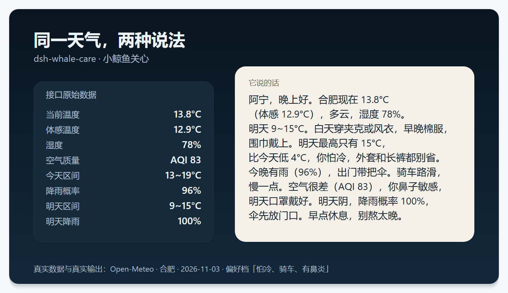
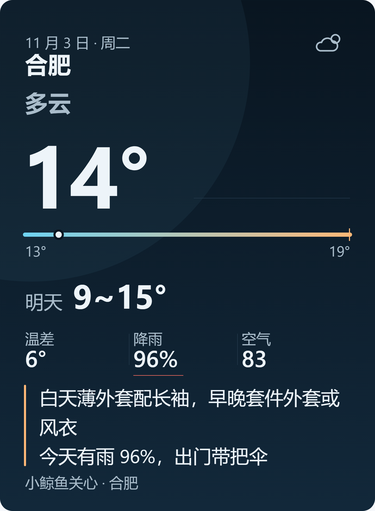
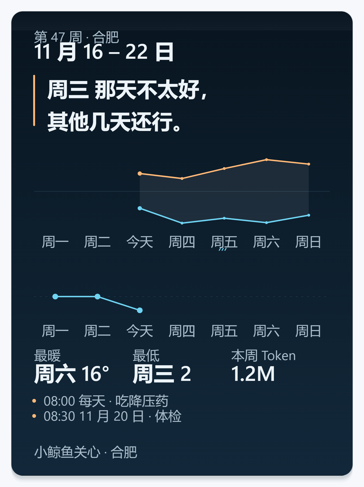
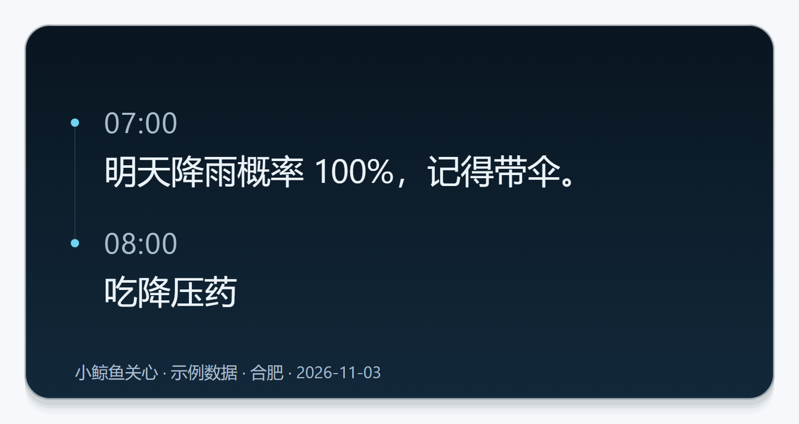

<p align="center">
  
</p>

<h1 align="center">小鲸鱼关心</h1>

<p align="center"><sub>dsh-whale-care · 教 agent 真正关心一个人</sub></p>

<p align="center">
     
</p>

<p align="center"><b>English</b> · <a href="README.en.md">README.en.md</a></p>

```bash
dsh plugin --profile web add github:fanyingnie2163663/dsh-whale-care
```

免费 · 无需 API Key · 不绑账号 · 偏好只存本机，不联网上传。

<sub>npm 上的已发布版是 0.5.7；要 0.6.0 请用上面这条 GitHub 安装。</sub>

## 快速开始

装好、重启 dsh 之后，三分钟就能用起来。先让它记住你是谁：

```bash
「记住：我在合肥，叫我阿宁，我怕冷，平时骑车上班，有鼻炎」
```

之后随口问：

```bash
「今天要带伞吗」「明天穿什么」「这周哪天最冷」
```

- **城市由你自己设**：没设之前它会直接说判断不了，不会偷偷用某个默认城市；临时换城市就在话里说（「上海今天要带伞吗」）。
- 什么都不问也行：每天早上主动说一条，可关，跟着你的作息走；
- 到点提醒吃药、带伞要宿主唤醒，见「接入 QQ」；版本门槛 dsh `0.1.2-rc.1` ~ `0.2.x`，`0.3` 未验证，peer 门禁会拒装。

## 它是什么
> 先算清楚，再把结论说成一段听着舒心的关心。

- **知道你是谁**：称呼、怕冷怕热、出行方式、有没有伞、健康备注，都由你设置；
- **知道现在几点**：早上说路上小心，晚上说早点休息，晚上不劝防晒；
- **只说有用的**：按影响排序，最多三条，不把规则表倒给你；
- **只存本地**：偏好在本机 `~/.dsh/whale-weather/profile.json`，不联网上传。

| 运行方式 | 能用什么 | 提醒会自己响吗 |
| --- | --- | --- |
| 只有 dsh | 八个工具全都能用 | 不会，只在 agent 醒来时顺带检查 |
| dsh + QQ | 八个工具，要加白名单 | 会，每 30 秒查提醒、07:00 / 18:00 查预警 |

## 看它怎么说


<sub>同一天气，两种说法：左边接口原始数据，右边它真实说出的话。</sub>

同一天、同一份偏好（合肥 · 2026-11-03 · 怕冷 / 骑车 / 有鼻炎），它说的是：

> 阿宁，晚上好。
> 合肥现在 13.8°C（体感 12.9°C），多云，湿度 78%。
> 明天 9~15°C。
> 白天穿夹克或风衣，早晚棉服，围巾戴上。
> 明天最高只有 15°C，比今天低 4°C，你怕冷，外套和长裤都别省。
> 今晚有雨（96%），出门带把伞。
> 骑车路滑，慢一点。
> 空气很差（AQI 83），你鼻子敏感，明天口罩戴好。
> 明天阴，降雨概率 100%，伞先放门口。
> 早点休息，别熬太晚。

<details>
<summary>偏好怎么改话术</summary>

| 偏好 | 效果 |
| --- | --- |
| `nickname` | 用对方希望被称呼的名字开头 |
| `coldSensitive` | 降温 3°C 就提醒，最低 ≤8°C 就保暖 |
| `heatSensitive` | 28°C 就提醒补水避暑 |
| `commute` = `bike` | 下雨说路滑慢点，大风说逆风别硬撑 |
| `commute` = `walk` | 下雨说路上积水绕着走 |
| `hasUmbrella` = false | 下雨改成「你平时老忘带伞，今天记得塞包里」 |
| `notes` 含「鼻 / 咽 / 哮喘 / 过敏」 | 空气差时提醒鼻子敏感、口罩戴好 |

</details>

## 八个工具
装好之后，agent 的工具列表里就有这八个，都不需要 API Key。

| 工具 | 一句话 |
| --- | --- |
| `weather` | 详细播报：当前、空气、三天预报、常规建议 |
| `weather_care` | 关心版：按偏好和时段写成一段能直接发出去的话 |
| `care_brief` | 短版关心：挑最多三条 + 今天到点的提醒 |
| `weather_profile` | 偏好读写：城市、称呼、冷暖、出行、伞、备注 |
| `weather_reminder` | 提醒：每天 / 每周几 / 一次性 / 每年，或按天气条件 |
| `weather_alert` | 极端天气预警，黄橙红三级，当天不重复 |
| `weather_card` | 生成 720×980 天气卡（SVG），宿主转图发送 |
| `weather_mood` | 情绪打分 1~5 的记录、回看与趋势 |

<details>
<summary>详细播报包含什么</summary>

- 当前温度 / 体感 / 天气现象 / 湿度 / 风速 / 能见度；空气 AQI + PM2.5 + 五档等级（优 / 良 / 中等 / 较差 / 很差）；
- 三天高低温、天气、降雨概率、风力；建议最多 4 条，命中才说（降雨 ≥40%、风 ≥30km/h、温差 ≥10°C、降温 ≥5°C、最低 ≤5°C、紫外线 ≥6、AQI 分档）；
- 中文天气描述内置 40+ 条 WWO 映射，wttr 的 `lang_zh` 实测不翻译。

示例输出（合肥 · 2026-11-03 快照）：

```text
合肥 现在 13.8°C（体感 12.9°C），多云，湿度 78%，风 18km/h
空气质量 很差（AQI 83，PM2.5 62μg/m³）
今天（11-03）13.2~19°C 多云，降雨概率 96%，风 18km/h
明天（11-04）9~15°C 阴，降雨概率 100%，风 24km/h

建议：
· 降雨概率最高 100%，出门记得带伞
· 空气很差，尽量待在室内
```

</details>

<details>
<summary>参数与字段</summary>

`weather`、`weather_care` 吃两个参数：`city`（不传用 profile 里的城市）、`days`（1~3，默认 3）。`weather_profile` 的字段：

| 字段 | 说明 |
| --- | --- |
| `city` | 默认城市 |
| `nickname` | 希望被怎么称呼 |
| `coldSensitive` | 怕冷：降温 3°C 就提醒，最低 ≤8°C 就保暖 |
| `heatSensitive` | 怕热：28°C 就提醒补水避暑 |
| `commute` | `walk` / `bike` / `transit` / `drive` / `none` |
| `hasUmbrella` | 是否随身带伞 |
| `notes` | 健康备注，如「有鼻炎」 |
| `dailyCare` | 每天早上那条主动关心，`false` 关掉 |
| `careTime` | 固定时刻 `HH:MM`；不设就跟作息自适应 |

出差另有两个字段：`travelCity`（优先用它查天气）、`travelUntil`（用到哪天，次日自动回退）。

</details>

<details>
<summary>预警阈值怎么定</summary>

| 类型 | 黄 / 橙 / 红 |
| --- | --- |
| 暴雨 | 降水 25 / 50 / 100 mm |
| 大风 | 风速 50 / 62 / 75 km/h |
| 高温 | 最高 35 / 37 / 40°C |
| 低温 | 最低 -10 / -20°C（橙 / 红） |
| 寒潮 | 24 小时降温 8 / 12 / 16°C |
| 雷电 · 沙尘 | 天气现象含「雷」「沙尘」记黄 |
| 大雾 | 能见度 ≤1km 黄，≤0.5km 橙 |
| 空气污染 | AQI 60 / 80 / 100（欧洲 AQI 口径） |

按预报本地估算，不是气象台正式预警；同一天同类型只报最高那一级。

</details>

<details>
<summary>换天气源</summary>

| 源 | 说明 |
| --- | --- |
| `wttr`（默认） | wttr.in，中文映射插件自己做，数据全但依赖单点 |
| `openmeteo` | Open-Meteo，地理编码 + 预报 + 空气，免费无 Key |
| `custom` | 自己写模块，导出 `fetchWeather` 即可 |

优先级：环境变量 `DSH_WEATHER_PROVIDER` > `config.json` 的 `provider` > 默认 `wttr`；失败按 `fallback` 依次重试。

```json
{
  "provider": "openmeteo",
  "fallback": ["wttr"],
  "customModule": "/opt/weather/my-provider.mjs"
}
```

自定义源只要返回统一结构（见 `lib/providers.js` 头注释）：

```js
export async function fetchWeather(city, { days = 3 } = {}) {
  return {
    place: city,
    now: { temp: 20, feels: 19, desc: '晴', humidity: 55, wind: 8, visibility: 10, uv: 4 },
    air: { aqi: 45, pm25: 20 },
    days: [{ label: '今天', date: '10-30', min: 12, max: 22, desc: '晴', rain: 10, wind: 12 }],
  };
}
```

</details>

<details>
<summary>接入别的插件的印象</summary>

定义：写在本机 `$DSH_HOME/whale-weather/user-context.json` 的**外部插件用户印象快照**，本插件只读不写，也不依赖它；没有这个文件一切正常。

- `profile.json` 的值永远优先，快照只补没填的字段：出行方式、怕冷怕热、健康备注；`version` 不是 1、缺 `updatedAt`、或超过 7 天没更新一律当没有（示例里的毫秒值照抄迟早过期，写文件时换成 `Date.now()`）；
- 只做关键词匹配（骑车 / 步行 / 公交 / 开车，怕冷 / 怕热，鼻炎 / 过敏），匹配不上就不猜；写快照是宿主的事。

```json
{
  "version": 1,
  "updatedAt": 1794960000000,
  "source": "qq-bridge",
  "user": {
    "qq": "100000001",
    "displayName": "示例用户",
    "traits": ["平时骑车上班", "有鼻炎"],
    "interactionCount": 3,
    "lastSeenAt": 1794864000000
  }
}
```

</details>

## 卡片与提醒
<p align="center"></p>

不是一屏数据，是一张卡：今天、明天、最多三条建议。

- 当前温度、今天区间、温差 / 降雨 / 空气、穿衣与带伞、明日预告；
- 存到 `$DSH_HOME/whale-weather/cards/weather-*.svg`，宿主用 `ffmpeg` 转 PNG 再发；没有 ffmpeg 或字体时返回可读错误，不影响文字播报。

<sub>720×980 的天气卡，宿主转成图片直接发到聊天里。</sub>

<p align="center"></p>

周卡（`weather_card` 的 `period: "week"`）：在一个 ISO 周里，温度往右长（今天→周日）、情绪往左长（周一→今天），最右边是本周 token 用量。

<sub>同一份冻结样本：合肥 · 2026-11-18。</sub>

提醒不是另一套东西，是同一张卡的时间版。



- 一个提醒 = 时间 + 触发条件 + 内容；天气条件在到期那一刻用最新预报评估；
- 时间表四选一：每天 / 每周几（`days`）/ 一次性（`date`）/ 每年（`yearly`）；存 `reminders.json`，同一天不重复，有 2 小时补发窗口。

<sub>到点自己响：带伞、吃药、生日，只在命中时说。</sub>

情绪：`weather_mood` 把「今天怎么样」变成可回看的趋势，`action=log` 打分 1~5（1=很差，5=很好），`action=list` 最近 10 条，`action=trend` 最近 N 天均分；存 `mood.json`，最多 500 条。

每日关心：宿主可以每天早上替你发一条 `weather_care`，开关是 `dailyCare`、时刻是 `careTime`；不设就跟作息自适应。

## 接入 QQ
只有想让 agent 在 QQ 上说话时才需要这一步；只用 dsh 可以跳过整节。

本插件不依赖 qq-bridge，它只是可选宿主：多给两样东西——执行期工具白名单、定时唤醒。qq-bridge 的 `qq-chat-v2` preset 默认拒绝非 MCP 工具，把八个工具名加进 `SAFE_EXACT`：

```js
const SAFE_EXACT = new Set([
  'ask_user_question', 'todo_write',
  'weather', 'weather_care', 'care_brief', 'weather_profile',
  'weather_reminder', 'weather_alert', 'weather_card', 'weather_mood',
])
```

改完重启 dsh，否则模型会收到 `工具 "weather" 不在 QQ 桥接白名单内`。宿主侧的定时能力用环境变量配：

```text
QQ_WEATHER_ALERT_TIMES=07:00,18:00
QQ_WEATHER_ALERT_TARGET=private:123456789
QQ_WEATHER_ALERT_ENABLED=false
```

## 隐私与许可

| 用途 | 服务 | 发送的数据 |
| --- | --- | --- |
| 天气 | [wttr.in](https://wttr.in) | 城市名 |
| 空气质量 | [open-meteo.com](https://open-meteo.com) | wttr 返回的经纬度 |

不发送账号、密钥或聊天内容，插件也不收集任何使用数据。

两个服务都免注册：wttr.in 是社区服务可能限流，Open-Meteo 免费额度仅限非商业用途，请勿高频滥用。

MIT，天气数据版权归上述两家所有。

## 开发
```bash
npm run check                             # 类型 + lint + 单测，不需要网络
node scripts/demo.mjs                     # 详细播报（城市取 profile.json）
node scripts/demo.mjs <城市>               # 详细播报（临时指定城市）
node scripts/demo.mjs <城市> care          # 关心版
```

目录：

```text
lib/weather.js     纯逻辑：wttr 解析 + 中文映射 + 详细建议
lib/openmeteo.js   Open-Meteo：地理编码 + 预报 + 空气质量
lib/providers.js   天气源抽象：选择 / 降级 / 自定义模块
lib/care.js        关心层：传感器 → 判断 → 说话（engine/ 是判断层）
lib/profile.js     偏好读写（$DSH_HOME/whale-weather/profile.json）
lib/user-context.js  可选：读其他插件的用户印象快照（只读、7 天过期）
lib/reminders.js   统一提醒：时间表、去重、天气条件评估
lib/alerts.js      极端天气预警：阈值分级 + 当天去重
lib/festivals.js   节日 / 节气表（2026–2027）；lib/mood.js 情绪记录
lib/card.js        天气卡 SVG（720×980）
lib/index.js       dsh 适配：只做接线；lib/tools/*.js 八个工具各一个文件
scripts/           demo.mjs 演示脚本；render-readme-assets.mjs 渲染 README 三张图
test/*.test.js     node --test 单测（15 个文件）
```

<details>
<summary>Roadmap</summary>

- [x] 当前天气 / 三天预报 / 空气质量
- [x] 带伞、加衣、防风、温差、紫外线、AQI 建议
- [x] 关心版话术 + 本地偏好档案（称呼、怕冷怕热、出行、伞、备注）
- [x] 出行方式中性化（不止「上班」）
- [x] 统一提醒引擎：定时 + 天气条件 + 宿主定时唤醒
- [x] 分时段温度（9 / 15 / 21 点）
- [x] 极端天气预警八类
- [x] 可切换天气源（wttr / openmeteo / 自定义）
- [x] 穿衣建议（按温度带分白天 / 早晚）
- [x] 每日主动关心（可开关、跟随作息）
- [x] 可选的用户印象接入
- [x] 上架 awesome-dsh-plugin 插件市场
- [x] 一次性 / 每年提醒（生日与纪念日）+ 逐小时降雨峰值
- [x] 多城市 / 临时切换（出差、旅行自动回退）
- [x] 天气卡片（SVG，宿主转图发送）
- [x] 情绪记录与趋势（weather_mood）
- [ ] 农历生日 / 农历节日
- [ ] 英文输出（i18n）

</details>
